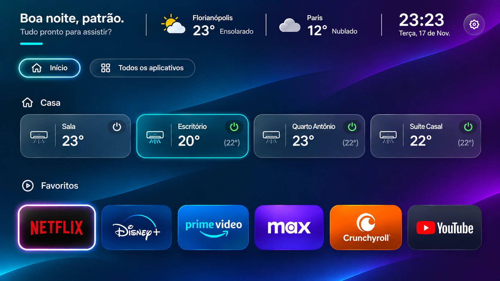

# goular-launcher

Launcher pessoal para Fire TV Stick: saudação, clima, relógio, controle dos
ar-condicionados da casa e atalhos para os apps de streaming.



**Stack:** UI em React + Vite + TypeScript, rodando num WebView dentro de uma casca
Android mínima em Kotlin. Navegação por controle remoto com
`@noriginmedia/norigin-spatial-navigation`.

## Começo rápido

Ver a UI no navegador (setas, Enter e Esc simulam o controle):

```bash
npm run setup   # só na primeira vez (instala as dependências de web/)
npm run dev     # abre em http://localhost:5173
```

Instalar no Fire Stick (depois de preparar o ambiente):

```bash
FIRE_TV_IP=192.168.0.42 scripts/deploy.sh
```

## Documentação

| | |
|---|---|
| [00 — Plano](docs/00-plano.md) | decisões, fases, critérios de pronto |
| [01 — Arquitetura](docs/01-arquitetura.md) | como web e nativo conversam |
| [02 — Ambiente](docs/02-ambiente.md) | Node, Android Studio, Gradle, adb |
| [03 — Layout e frontend](docs/03-layout-frontend.md) | tokens, foco, desempenho, skills do Claude |
| [04 — Fire Stick](docs/04-firestick.md) | modo dev, instalar, botão Home, live reload |
| [05 — Integrações](docs/05-integracoes.md) | Open-Meteo, Home Assistant, ponte nativa |

## Comandos

Rode da raiz do projeto; os atalhos repassam para `web/` (ou rode direto dentro de `web/`).

| Comando | O quê |
|---|---|
| `npm run setup` | instala as dependências de `web/` |
| `npm run dev` | preview no navegador |
| `npm test` | testes unitários |
| `npm run typecheck` | checagem de tipos |
| `npm run build` | gera a UI em `android/app/src/main/assets/www` |
| `scripts/deploy.sh` | build completo + instala no Fire Stick |
| `scripts/dev-tv.sh` | TV carregando a UI do Vite (live reload) |
| `scripts/enable-home-watcher.sh` | Goular assume o botão Home |
| `scripts/disable-home-watcher.sh` | desfaz o anterior |
